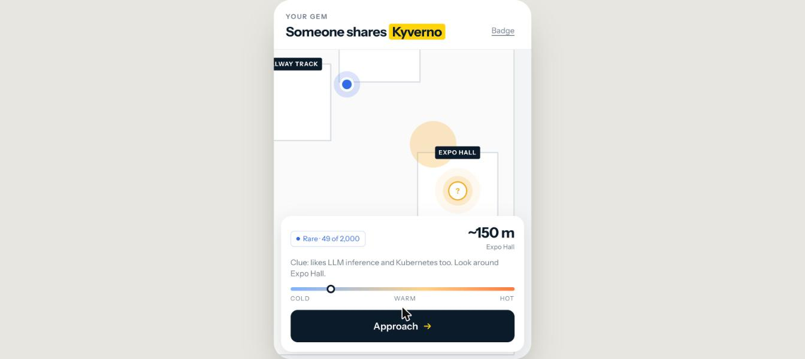
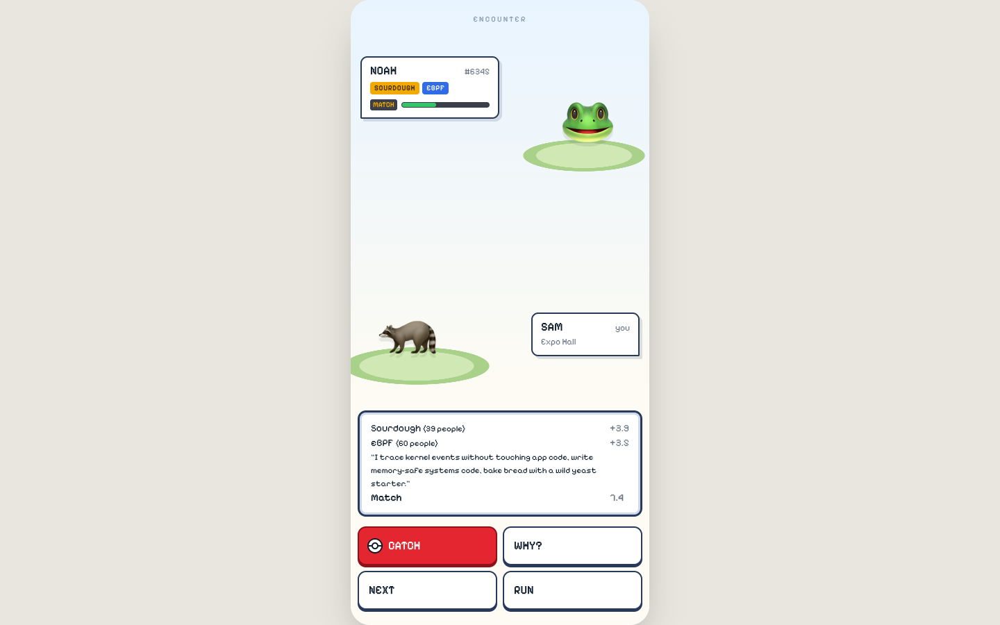
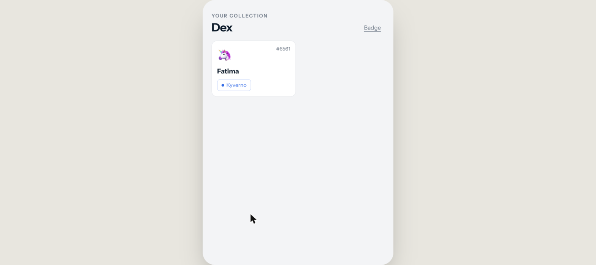
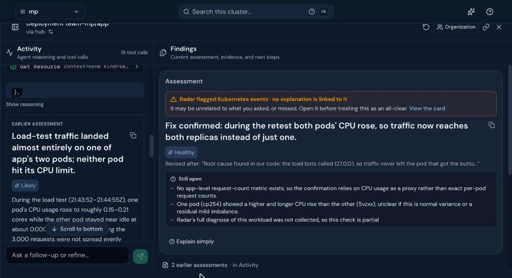

# Pokémon Go for People

**Find the one person at KubeCon you should meet, where rare interests count most. Then hunt them on the venue map and catch them.**

🎮 Live: https://mp.cnh.radarhq.io · 🎬 Video (3 min): TODO link

At a 10,000-person conference, everyone shares "Kubernetes". That match is worthless. The person who also does eBPF *and* sourdough is the one worth finding. This app scores matches by **how rare** each shared interest is, shows the rarest one as your "gem", and turns finding that person into a game.

> The crowd is **2,000 simulated bot attendees** (labelled in the app). No real user data.

| Hunt | Battle | Collection |
|---|---|---|
|  |  |  |

## How it works

1. Type your interests as tags (free words work too: "kernel tracing").
2. **Elasticsearch** finds your best matches. Score = sum of shared interests, each weighted by its rarity in the crowd (BM25 / IDF). Common interests give ~0 points.
3. The rarest shared interest is your **gem**: common / rare / legendary.
4. Hunt your match on the venue map. The battle screen shows what you share.
5. Catch them → their card goes into your collection.

The **"Keynote ends"** button simulates 3,000 people leaving the keynote at once: a bounded load burst (60 s, 3,000 requests, 25 in flight). This is the spike we observe, investigate and fix with the sponsor tools below.

## Sponsor tools — evidence

| Tool | What we did | Proof |
|---|---|---|
| **Elastic** | Main data store (`players` index). **Hybrid search**: BM25 rarity on tags + **Jina** semantic search on `bio` (`.jina-embeddings-v5-text-small`), fused with **RRF**. Crowd stats cached 30 s. | [PR #4](https://github.com/mattia-palmieri/pokemon-go-for-people/pull/4), `app/server.js`, `app/seed.js` |
| **Dash0** | OpenTelemetry traces from the Node app. **Agent0 find → fix → prove**: found a sequential `_count` call on every match; we cached it; Agent0 confirmed **avg −38%, p95 289 → 184 ms**. | [PR #2](https://github.com/mattia-palmieri/pokemon-go-for-people/pull/2), [table below](#dash0-agent0-find--fix--prove), [Agent0 find](docs/evidence/dash0-agent0-find.jpg), [Agent0 prove](docs/evidence/dash0-agent0-prove.jpg) |
| **Radar** | App runs on the organizers' Kubernetes cluster via Argo CD. **Radar Checks 4 → 0**. **AI investigation** on the keynote spike: load hit only 1 of 2 pods → we routed it through the Service → both pods share it, p50 139 → 109 ms. | [PR #3](https://github.com/mattia-palmieri/pokemon-go-for-people/pull/3), [PR #5](https://github.com/mattia-palmieri/pokemon-go-for-people/pull/5), [STORY.md](STORY.md), [investigation](docs/evidence/radar-investigation.jpg) |
| **Gitar** | Every change went through a PR that Gitar reviewed (PRs #1–#6). Gitar **caught 2 real bugs** in PR #4. Our own review context (`.gitar/review/project.md`), a deploy-safety rule (`.gitar/rules/deploy-safety.md`), auto-apply criteria, and a CI test job on every PR. | [PR #4 review](https://github.com/mattia-palmieri/pokemon-go-for-people/pull/4), [PR #6](https://github.com/mattia-palmieri/pokemon-go-for-people/pull/6), [`.gitar/`](.gitar/) |

### Dash0 Agent0: find → fix → prove

**Find.** During a keynote spike (3,011 traces), Agent0 showed avg 171 ms = 86 ms `POST /players/_search` + 83 ms `GET /players/_count`, called one after the other. App code < 2 ms. The `_count` has no query, so its answer is the same for every request.

**Fix.** [PR #2](https://github.com/mattia-palmieri/pokemon-go-for-people/pull/2): 30 s in-memory cache for the player count, one shared refresh, stale value on error.

**Prove.** Same spike again (3,000 traces):

| | Before | After |
|---|---|---|
| Avg / p95 | 170.7 / 289 ms | 106.2 / 184 ms (**−38% / −36%**) |
| Elastic calls per request | 2 | 1 |
| `_count` calls | 3,000 | 1 |
| Throughput | ~127 req/s | ~159 req/s |

### Radar: Checks 4 → 0

Before ([STORY.md](STORY.md)): 4 Medium findings on `Deployment/team-mp/app` — `automountServiceAccountToken`, `readOnlyRootFs`, `missingPDB`, `missingTopologySpread`. [PR #3](https://github.com/mattia-palmieri/pokemon-go-for-people/pull/3) fixed all 4 (service-account token off, read-only root FS, PodDisruptionBudget, topology spread over 2 pods). After: 0.

### Radar: AI investigation

**Find.** During a "Keynote ends" spike (3,000 requests, 0 failed, p50 139 ms) we asked Radar's AI investigation to check `Deployment/team-mp/app`. Radar: *load-test traffic landed almost entirely on one of app's two pods* (one pod ~0.2 cores, the other idle). Its advice: do not add CPU or replicas; fix the traffic distribution. Our root cause in code: the load bots called `127.0.0.1`, so traffic never left the pod that got the button press.

**Fix.** [PR #5](https://github.com/mattia-palmieri/pokemon-go-for-people/pull/5): the bots call the `app` Service (`KEYNOTE_TARGET=http://app`).

**Prove.** Same spike again. Radar: *"Fix confirmed: … traffic now reaches both replicas instead of just one."*

| | Before | After |
|---|---|---|
| Busy pod CPU | 0.21 cores | 0.13 cores |
| Other pod CPU | ~0.001 (idle) | 0.115 (working) |
| p50 / p95 | 139 / 293 ms | 109 / 257 ms |



## Architecture

```
Browser (app/public)  ──►  Node.js server (app/server.js, no framework)
                               │  OpenTelemetry auto-instrumentation ──► Dash0
                               ▼
                          Elastic Cloud: players index (BM25 + Jina, RRF)

GitHub PR ──► Gitar review ──► merge to main ──► GitHub Actions builds image (GHCR)
          ──► deploy/kustomization.yaml bumped ──► Argo CD ──► Kubernetes (team-mp, 2 pods)
                                                                 ▲
                                                          Radar: Checks + AI investigation
```

API: `GET /api/match`, `GET /api/me`, `GET /api/heat`, `GET /api/keynote`, `POST /api/catch`, `GET /api/version`.

## Run it yourself

Needs Node 22 and an Elastic Cloud deployment with the Jina inference endpoint.

```bash
cd app
npm ci
cat > ../.env <<'EOF'
ELASTIC_URL=https://<your-deployment>.es.<region>.elastic.cloud
ELASTIC_API_KEY=<api key>
EOF
node --env-file=../.env seed.js 2000   # create the 2,000 bot attendees
node --env-file=../.env server.js      # http://localhost:8080
```

Traces to Dash0 (optional): set `OTEL_EXPORTER_OTLP_ENDPOINT=<dash0 otlp endpoint>` and `OTEL_EXPORTER_OTLP_HEADERS="Authorization=Bearer <dash0 token>"`, and run with
`NODE_OPTIONS="--require @opentelemetry/auto-instrumentations-node/register"` (see `deploy/deployment.yaml` for the full OTel env).

Deploy: `deploy/` (Kustomize) + `argocd/`. Push to `main` → GitHub Actions builds and pushes the image → Argo CD syncs.

## Inclusion

- Clues are interests, never looks.
- The map shows a venue **zone**, never a person's exact position (`app/server.js`).
- Next, not built yet: both people must say yes before a catch; a "do not disturb" switch.

## Built with AI

Built during the hackathon by Matt with Claude Code (code, docs) and the sponsor AI agents (Dash0 Agent0, Radar AI investigation, Gitar review). Full history is in the commits and PRs.

## Not affiliated

Pokémon words are used as a joke. No Nintendo logos or art. Not affiliated with Nintendo or The Pokémon Company.
